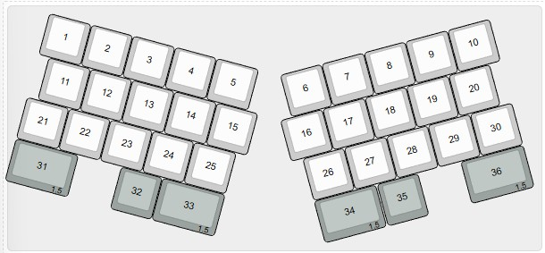
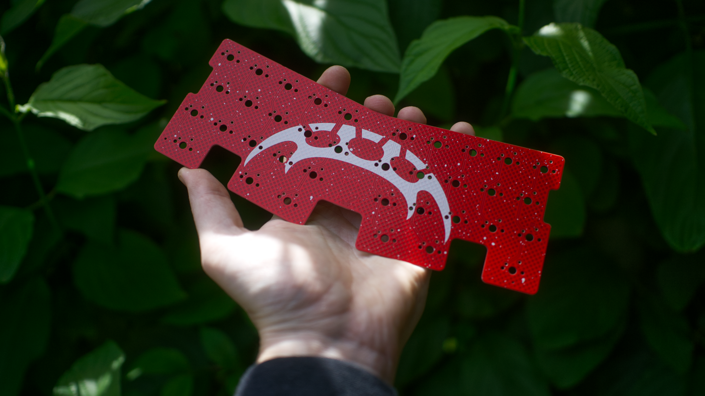
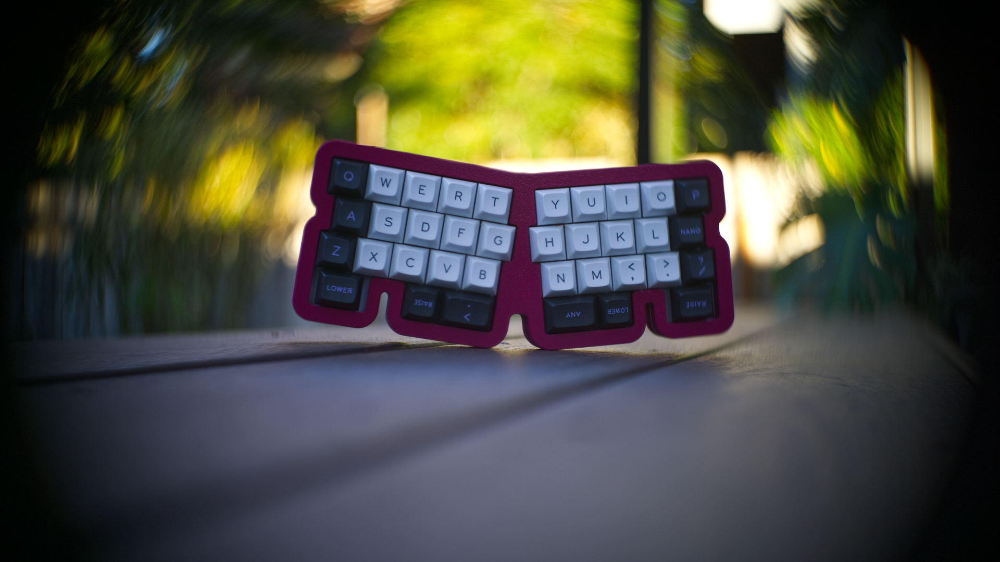

# **Bat'leth**

### These PCBs are confirmed working as of 6/9/26!

Bat'leth is:
- Integrated STM32F072
- 10u treadstone layout
- Unibody split layout
- Forced layout, forced solder
- Mounting needs to be handled by the plate

Shoutout [Ottimo](https://github.com/subottimale) for suggesting the name/theme based off the shape of the PCB


### In this repo you will find:
```
- Layout options
- Renders of PCB
- STEP model of PCB
- Edgecuts
- Firmware BIN and source
```

VIAL firmware commissioned by [Moinboards.](https://moinboards.de/) Thank you again so much!


### KLC layout


### PCB front


### Full build

